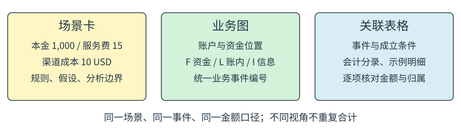
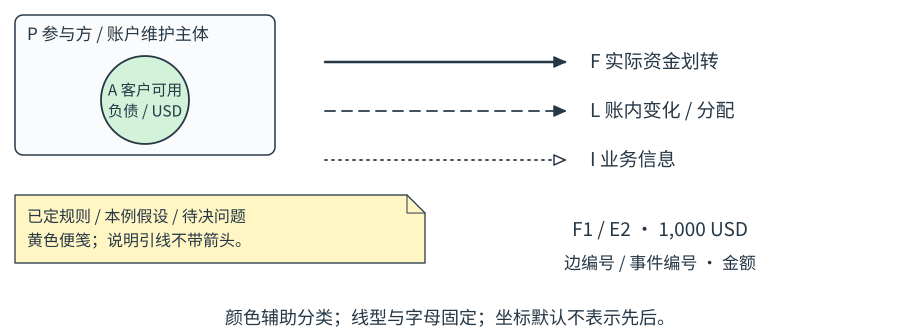
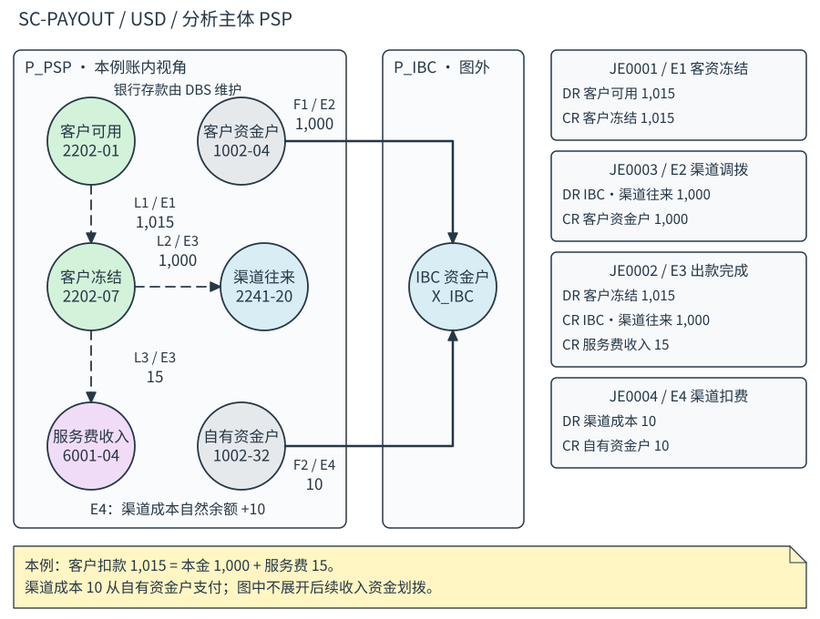
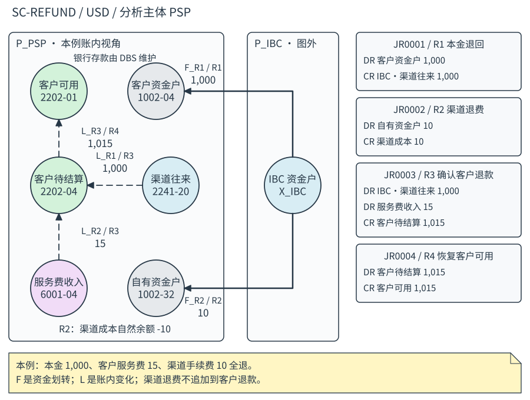
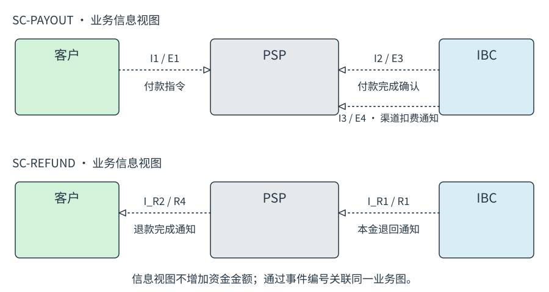

# 金融交易图示法

Financial Transaction Notation · FTN 1.1 · 业务分析版

**状态：团队试用提案**　**日期：2026-10-17**

用于描述一笔业务中，机构与客户之间的资金流、客户余额及往来账的变化、收入与成本归属，以及相关业务信息。供业务、产品、财务和研发共同分析、设计与沟通。

**核心表达：场景卡 + 业务图 + 事件表 + 分录表 + 示例明细。** 图提供整体关系，表提供精确金额和账户对应，场景卡限定本例适用的规则。



**沿用的风格：**圆形账户节点、机构外框、方向箭头、柔和配色和黄色便笺。颜色仅辅助分类，字母、线型与文字共同表达含义。

**规范用语：**“必须”为基本约束；“应”为默认做法；“可以”为可选能力。小场景可以只用必要符号，不要求填写机器格式。

**范围边界：**本规范关注业务含义及其账务映射，不定义 API 调用、超时、重试、幂等、数据库提交或系统运行状态。业务上的付款完成、费用确认和退款条件仍需明确。

**示例来源：**用户的 Whimsical「Payout Transaction」，保留出款本金 1,000 USD、客户服务费 15 USD、渠道手续费 10 USD，以及出款、退款两类场景。下文明确列出新增假设与修订，不将其当作原板已经确定的事实。

<!-- pagebreak -->

## 1. 一张业务分析图的组成

| 内容 | 必须回答的问题 |
| --- | --- |
| 场景卡 | 什么产品、什么场景、采用哪些业务规则？ |
| 对象字典 | 谁参与？每个圆圈表示什么账户或资金位置？ |
| 业务图 | 钱流向哪里？账内如何变化？传递什么业务信息？ |
| 事件表 | 什么业务条件成立时，发生哪些资金与账务效果？ |
| 分录表 | 具体影响哪些会计账户，借贷金额分别是多少？ |
| 示例明细 | 订单、交易、清算及账务记录如何对应？ |

简单场景可把这些内容放在同一画板；文档可以分多页，但必须保留共同编号。业务图及其表格应使用同一场景版本。

**页眉最小字段：**场景编号、名称、版本、分析主体、币种、适用前提。实际日期只有在影响规则或业务顺序时才需要填写。

**图面默认是关系图。** 左右、上下位置用于排版，不自动表达时间、资金规模或优先级。需要说明先后时，在事件表填写前置事件，或增加业务阶段标签。事件编号本身不表示先后。

**图外边界必须说明。** 本例分析主体为付款服务商 PSP，渠道为 IBC，银行为 DBS；收款人侧的后续资金路径不展开。渠道获得资金不自动等于最终收款人到账。

**避免金额重复汇总。** 同一笔 1,000 USD 可以同时出现在资金箭头、渠道清算记录和客户付款记录中。这些是同一业务的不同表达，不是三笔客户支出；合计必须声明统计口径。

<!-- pagebreak -->

## 2. 节点、边与便笺



| 符号 | 含义及写法 |
| --- | --- |
| P 机构外框 | 参与方或账户维护主体；标名称与角色 |
| A 圆形节点 | 一个明确账户或图外资金位置；标短名、币种和稳定编号 |
| F 实线实心箭头 | 实际资金划转；两端为资金账户，写金额与事件编号 |
| L 长虚线实心箭头 | 账内余额变化、重分类或分配；写金额与事件编号 |
| I 点线空心箭头 | 业务指令、业务结果、费用或结算通知；两端为参与方 |
| N 黄色折角便笺 | 规则、假设、解释或待决问题；如有引线，不带箭头 |

F、L、I 的线型固定，不随业务进度改变。黑白打印时仍可通过前缀和箭头识别；图面拥挤时，可以把 I 单独画成信息视图，用事件编号与资金图关联。

**节点不能只写“银行”或“渠道”。** 应区分“DBS·客户资金户”“DBS·自有资金户”“IBC·渠道资金户”和“IBC·渠道往来”。前两者是银行存款，第三个是外部资金位置，第四个是 PSP 账上的往来账户，不能合并成一个账户。

“客户余额·可用”“客户余额·冻结”表示客户应付款的不同分类；“服务费收入”“渠道成本”表示损益账户。圆圈统一表示账户，账户性质由字典明确。

外框默认按**记录由谁维护**分组。PSP 账内的银行存款节点写明维护银行 DBS；这只是 PSP 分析视角，不表达法律所有权或受益权结论。需要这些关系时，应另行标注。

<!-- pagebreak -->

## 3. 事件、分录与形式语义

**业务事件 E**是有业务含义的事实或条件，例如“客户付款金额冻结”“渠道资金调拨”“出款完成”“渠道费用扣收”。每个事件必须给出名称、成立条件、所属订单和前置事件；金额效果通过 F、L 与 J 表达。一个事件可以有多条边和多行分录，不表示一次技术调用。

```text
D = (S, P, A, E, F, L, I, J, T)
S = 场景卡及适用规则       P = 参与方集合
A = 账户 / 外部资金位置    E = 业务事件集合
F = 资金划转集合           L = 账内变化集合
I = 业务信息集合           J = 会计分录集合
T = 订单及业务明细集合
```

```text
Account = (id, name, party, currency, nature, code?, bank?)
Event   = (id, name, order_ref, condition, after[])
Flow    = (id, kind=F/L, from, to, Money, event_ref)
Info    = (id, from_party, to_party, meaning, event_ref)
Journal = (id, event_ref, rows[(account_ref, DR/CR, Money)])
Record  = (id, order_ref, perspective, meaning, Money, event_refs[])
Money   = (currency, minor)   // 正整数最小单位；USD 的 minor=100 表示 1 USD
```

**F 的方向**表示实际资金由转出账户流向转入账户。**L 的方向**表示本图口径下，某账户的自然余额减少并分配到另一账户的自然余额增加。它不等于统一的“借方到贷方”：资产减少是贷记，负债减少是借记，必须通过账户性质和分录解释。

对账户 a，令 DR(a)、CR(a) 为某事件下所有分录的借贷发生额：

```text
资产、费用：Δbalance(a) = DR(a) - CR(a)
负债、收入：Δbalance(a) = CR(a) - DR(a)
L 图中：ΔL(a) = Σ流入 L - Σ流出 L
```

L 涉及的账户必须满足 ΔL(a)=Δbalance(a)。若一种会计处理无法自然表达为这种分配，直接用事件及分录表说明，不强画 L。每个事件可选择展示部分账户，但不得把未展开部分称为完整账务图。

每一笔 J 在同一记账主体、同一币种内必须满足 ΣDR=ΣCR。不同性质账户的自然余额增减不能直接相加验证借贷平衡；F 与 L 是不同视角，也不得合并相加。

<!-- pagebreak -->

## 4. 场景卡与账户字典

**SC-PAYOUT：SWIFT 出款，客户本金 1,000 USD，服务费 15 USD，渠道成本 10 USD。** 分析主体为 PSP，币种 USD。本例采用如下规则；其中成本扣收方式及确认时点是为闭合示例而明确选定的口径。

| 规则 | 本例采用的口径 |
| --- | --- |
| 客户扣款 | 可用余额先转冻结 1,015；出款完成时结转本金与服务费 |
| 渠道资金 | PSP 客户资金户向 IBC 渠道资金户调拨 1,000 |
| 资金与往来 | 调拨先形成渠道往来借方发生额，出款完成再贷记抵销 |
| 客户服务费 | 出款完成时确认收入 15；此处不另画银行账户间的收入资金划拨 |
| 渠道成本 | 出款完成后，按该笔业务单独扣收 10，非月结 |
| 成本扣款账户 | DBS 自有资金户；本例在扣收事件同时确认成本 |
| 展开边界 | 不含 FX、分润、中间行费用、最终收款人银行及税费 |

**账户编号为示例业务字典，沿用原板编码。** 名称存在差异时，本规范以下表为准，不主张这是已经批准的正式科目表。

| 节点 | 科目 / 性质 | 含义 |
| --- | --- | --- |
| A_AVAIL | 2202-01 / 负债 | 应付客户款·可用，PSP 维护 |
| A_FROZEN | 2202-07 / 负债 | 应付客户款·冻结，PSP 维护 |
| A_TRANSIT | 2202-04 / 负债 | 应付客户款·待结算，退款中使用 |
| A_BANK_C | 1002-04 / 资产 | 银行存款·DBS 客户资金户 |
| A_BANK_O | 1002-32 / 资产 | 银行存款·DBS 自有资金户 |
| A_CHANNEL | 2241-20 / 负债 | 其他应付款·IBC 渠道往来，PSP 维护 |
| A_REVENUE | 6001-04 / 收入 | 服务费收入·付款 |
| A_COST | 6401-02 / 费用 | 渠道成本·交易 |
| X_IBC | 无 / 图外资金位置 | IBC 渠道资金户，不代表 PSP 的往来账 |

PSP 维护前八个账户；X_IBC 属 IBC，具体银行及内部科目未展开。收入与费用账户使用各自自然余额口径。渠道往来先出现借方发生额只是本例过渡安排，不代表任意时点的总余额为负。

<!-- pagebreak -->

## 5. 出款：业务图与事件表



图中实线 F 为资金划转，虚线 L 为账内变化。损益节点旁的增减说明属于同一事件的账务结果，不再构成一笔资金划转。

| 事件 | 业务成立条件 / 前置 | 图及分录对应 |
| --- | --- | --- |
| E1 客资冻结 | 客户付款业务获受理；无前置事件 | L1 1,015；JE0001 |
| E2 渠道调拨 | 为该笔出款向渠道划入资金；E1 后 | F1 1,000；JE0003 |
| E3 出款完成 | 获得渠道付款完成的业务确认；E2 后 | L2 1,000 + L3 15；JE0002 |
| E4 渠道扣费 | 本笔渠道费用实际扣收；E3 后 | F2 10；JE0004 |

E2 与 E3 是本例选定的业务顺序，其他渠道可采用预存资金等安排，应另建场景卡。编号 JE0003 早于 JE0002 出现是沿用原板标识，编号不承诺时间顺序。

<!-- pagebreak -->

## 6. 出款：分录与金额核对

分录统一以 PSP 为记账主体，单位 USD；每组借贷分别平衡。图边通过事件关联分录，不要求一条边对应一行分录。

| 分录 / 事件 | 借方 DR | 贷方 CR |
| --- | --- | --- |
| JE0001 / E1 | 2202-01 客户可用 1,015 | 2202-07 客户冻结 1,015 |
| JE0003 / E2 | 2241-20 渠道往来 1,000 | 1002-04 客户资金户 1,000 |
| JE0002 / E3 | 2202-07 客户冻结 1,015 | 2241-20 渠道往来 1,000；6001-04 服务费收入 15 |
| JE0004 / E4 | 6401-02 渠道成本 10 | 1002-32 自有资金户 10 |

**客户口径：**本次余额减少 1,015 = 本金 1,000 + 服务费 15。渠道成本 10 由 PSP 承担，不再追加为客户扣款。

**资金口径：**客户资金户流出 1,000，自有资金户流出 10，两者必须分开。收入确认 15 不表示银行中同时发生了 15 的划款；从客户资金户向运营资金户的后续资金划拨不在本例范围。

**账务口径：**在上述事件全部完成后，按自然余额计算本次净变化：

| 账户 | 净变化 USD | 解释 |
| --- | --- | --- |
| 客户可用 | -1,015 | 客户本金与服务费合计 |
| 客户冻结 | 0 | E1 增加 1,015，E3 减少 1,015 |
| 客户资金户 | -1,000 | 向渠道调拨本金 |
| 渠道往来 | 0 | E2 借记与 E3 贷记相抵 |
| 服务费收入 | +15 | E3 确认 |
| 渠道成本 | +10 | E4 确认 |
| 自有资金户 | -10 | E4 扣收 |

本例两项损益之差为 15 - 10 = 5 USD，不代表包含全部费用的业务净利润。上述为变动额，不是期末账户余额。

<!-- pagebreak -->

## 7. 出款：图与示例记录的对应

订单 **P00001**：类型“付款”，本金 1,000 USD，客户服务费 15 USD。下面保留原板 T00001-T00005 的分析条目，并补充视角与事件映射；这些是说明数据，不规定系统表结构。

| 明细 / 视角 | 业务含义与金额 USD | 事件 / 分录 |
| --- | --- | --- |
| T00001 / 客户 | 客户付款本金 1,000 | E3 / JE0002 |
| T00002 / 客户 | 出款服务费 15 | E3 / JE0002 |
| T00003 / 渠道费用 | 渠道手续费 10 | E4 / JE0004 |
| T00004 / 渠道清算 | 渠道出款单本金 1,000 | E3 / JE0002 |
| T00005 / 资金调拨 | 渠道调拨单 1,000 | E2 / JE0003 |

T00001 与 T00004 是同一本金的不同业务视角；T00005 说明资金准备路径。不能将三行相加作为客户付款 3,000。客户支出合计只取客户视角 T00001 + T00002。

**JE0002 的账务明细示例：**

| 明细 / Journal | 账户 / 借贷 | 自然余额变化 USD |
| --- | --- | --- |
| LE0003 / JE0002 | 2202-07 客户冻结 / DR 1,015 | -1,015 |
| LE0004 / JE0002 | 2241-20 渠道往来 / CR 1,000 | +1,000 |
| LE0005 / JE0002 | 6001-04 服务费收入 / CR 15 | +15 |

订单号、交易号、事件号、分录号及分录行号表示不同对象，不能互换。订单金额和分录总额也不能直接比较：JE0002 的借方总额 1,015 包括本金及服务费，而渠道出款本金为 1,000。

**展示层次可按沟通对象折叠。** 可使用原板的“订单 / 交易清算 / 账务”三层，也可把交易与清算分开为四层；两种排版必须保持同一套业务事件与金额含义。

<!-- pagebreak -->

## 8. 退款：场景卡与业务图

**SC-REFUND：原出款完成后的全额退回与客户退款。** 退款订单 R00001 关联原订单 P00001。本例假定渠道退回全部本金 1,000，PSP 退还客户服务费 15，渠道同时退还原手续费 10。费用是否退还是本例选定规则，不能推广到所有退款。

退款保留原出款，新增 R1-R4 事件与 JR0001-JR0004 分录。采用“渠道往来过渡、客户待结算归集”的口径；以便分别说明资金收到与客户可用余额恢复。



| 事件 | 业务成立条件 / 前置 | 图及分录对应 |
| --- | --- | --- |
| R1 本金退回 | 原本金已退入客户资金户 | F_R1 1,000；JR0001 |
| R2 渠道退费 | 原费用已退入自有资金户；独立于 R1 | F_R2 10；JR0002 |
| R3 确认客户退款 | 本金已回收，且客户服务费获准退还；R1 后 | L_R1 1,000 + L_R2 15；JR0003 |
| R4 恢复客户可用 | 客户退款金额由待结算转可用；R3 后 | L_R3 1,015；JR0004 |

R2 不是 R4 的前置条件：渠道退费是否到账不改变本例已批准的客户退款金额。若业务政策规定有关联，应在另一场景中明确。

<!-- pagebreak -->

## 9. 退款：分录与差额归属

| 分录 / 事件 | 借方 DR | 贷方 CR |
| --- | --- | --- |
| JR0001 / R1 | 1002-04 客户资金户 1,000 | 2241-20 渠道往来 1,000 |
| JR0002 / R2 | 1002-32 自有资金户 10 | 6401-02 渠道成本 10 |
| JR0003 / R3 | 2241-20 渠道往来 1,000；6001-04 服务费收入 15 | 2202-04 客户待结算 1,015 |
| JR0004 / R4 | 2202-04 客户待结算 1,015 | 2202-01 客户可用 1,015 |

**客户恢复：**本金 1,000 + 服务费 15 = 1,015。**资金恢复：**客户资金户 +1,000，自有资金户 +10。**损益变化：**收入 -15，成本 -10。本例退款与原出款合看，已展示账户的累计净变化均为 0，不意味着原交易被删除。

退款明细示例：RT00001 为客户本金退款 1,000（R3）；RT00002 为客户服务费退还 15（R3）；RT00003 为渠道退费 10（R2）。三者都关联退款订单 R00001，原订单引用为 P00001。客户退款总额不包含 RT00003。

**业务变体必须单列场景，不能只把原图某条线擦掉：**

| 变体 | 客户退款 USD | 渠道资金与费用影响 |
| --- | --- | --- |
| 退本金，客户服务费不退 | 1,000 | R3 不冲减服务费收入，R4 转可用 1,000 |
| 本金全退，渠道费用不退 | 依客户费用政策为 1,000 或 1,015 | 不发生 R2；原成本 10 保留 |
| 本金只退回 990，客户仍退本金 1,000 | 另依客户费用政策 | 明确差额 10 由谁承担、补足来源与账务；不能画成资金自然守恒 |
| 累计部分退款 | 本次本金与费用分别列示 | 记录原额、已退额、本次额、剩余额，逐项检查上限 |

本规范只完整演示前述全额退款；上表是场景拆分指引，未交付这些变体的完整分录。费用冲回与收入调整的具体会计政策，应由业务及财务共同确定。

<!-- pagebreak -->

## 10. 业务信息与业务阶段

I 表示参与方交换的业务含义，不描述网络或系统调用。信息内容可以带金额，但该金额不构成新的资金流。



| 信息 | 发送方 → 接收方 | 业务含义 / 关联事件 |
| --- | --- | --- |
| I1 | 客户 → PSP | 付款指令：本金 1,000，服务费 15 / E1 |
| I2 | IBC → PSP | 付款完成确认 / E3 |
| I3 | IBC → PSP | 本笔渠道费用扣收通知 10 / E4 |
| I_R1 | IBC → PSP | 本金退回结算通知 1,000 / R1 |
| I_R2 | PSP → 客户 | 退款完成通知 1,015 / R4 |

发送一份通知与实际资金变化是不同事实。事件成立条件由场景卡定义；图示中的业务确认是本例对 E3 的约定，不因此断言最终收款人银行已经入账。

业务阶段可以写“客户受理 / 资金准备 / 出款完成 / 费用扣收”和“资金退回 / 客户退款确认 / 余额恢复”。它们组织读图顺序，不要求增加状态机。

**讨论版便笺分类：**“已定规则”“本例假设”“待决问题”必须写在便笺开头。定稿后，把已经决定的规则收进场景卡，便笺保留原因和边界，避免规则散落在画布各处。

<!-- pagebreak -->

## 11. 可选机器表达与校验

人工画图即可符合本规范。需要交叉检查时，可用附带 JSON Schema 和静态校验器；它们服务于业务文档，不是系统接口或生产账务设计。

```json
{
  "id": "L2", "kind": "L",
  "from": "A_FROZEN", "to": "A_CHANNEL",
  "money": {"currency": "USD", "minor": 100000},
  "event_ref": "E3"
}
```

| 规则 | 文档要求 / 静态检查 |
| --- | --- |
| R01 对象引用 | 场景内 ID 唯一，账户、事件、订单及参与方引用存在 |
| R02 金额 | 已声明币种；正整数最小单位；禁止金额边用负数 |
| R03 端点 | F 连接资金位置；L 连接本主体账内账户；I 连接参与方 |
| R04 分录边界 | 每条分录只属一个事件；账户同记账主体、同币种 |
| R05 借贷平衡 | 每个分录逐币种 ΣDR=ΣCR |
| R06 账内投影 | 按事件汇总 L，对涉及账户逐项核对自然余额变化 |
| R07 资金投影 | 按事件汇总 F，核对图内银行账户的资金变动与分录 |
| R08 业务前置 | 前置事件存在、无自指、无循环；编号不推导先后 |
| R09 明细映射 | 示例记录关联存在的事件；订单与事件相符 |
| R10 退款范围 | 本次退款有原业务引用；各项已退 + 本次 ≤ 原额；所引用边的本次金额一致 |

机器样例为 examples/payout.json 与 examples/refund.json。R10 的原额与历史已退额由模型声明，校验器不查询真实交易；未画的账务、真实余额、费用政策正确性与账户合法使用由评审确认。

**人工审阅仍需检查：**场景前提是否获认可；每项金额是否有明确归属；图是否误把往来账当成外部资金户；客户支出与渠道成本是否混算；退款差额是否有人承担。工具通过不能替代这些业务判断。

**版本说明：**FTN 1.1 是按业务分析目标修订的提案。1.0 的快照、执行状态、重试及原子批次配置不沿用；JSON 格式与校验规则已经重新定义，不与 1.0 兼容。旧版可从 Git 历史取得。

<!-- pagebreak -->

## 12. 来源、假设与原板差异

**业务来源：**[Whimsical · Payout Transaction](https://whimsical.com/nanke-s-workspace/payout-transaction-NvkWtLCTtiyLkNKZs6rz4R)。保留原板 1,000 / 15 / 10 USD 金额、出款及退款场景、主要科目编码、订单及交易编号风格。未修改原 Whimsical 或 OmniGraffle 文件。

| 原板中的待明确处 | 本规范采用的示例处理 |
| --- | --- |
| 一个“银行”节点关联客户资金户和财务自有户 | 拆为 A_BANK_C 与 A_BANK_O；渠道实际收款位置也与渠道往来账分开 |
| “图为实扣”及“不随交易实时扣除”的描述 | 明确为出款完成后逐笔单独扣收，非月结；本例扣收时确认成本 |
| 注释提问从客户资金还是运营资金扣费 | 选定自有资金户承担 10；是本例假设，不是已确认业务规则 |
| 客户付款、服务费关联 JE0001，但该编号又表示冻结 | 统一关联 JE0002；JE0001 专用于冻结，JE0003 用于调拨 |
| P00001 与 P0001 混用 | 原订单统一为 P00001；退款另设 R00001 并关联原订单 |
| 冻结及退款在途都出现 2202-07 | 冻结使用 2202-07；退款待结算使用字典中的 2202-04；编码归属仍需团队确认 |
| 退款首组 CR 渠道往来 1,010，DR 银行 1,000 | 本金退回与渠道退费分开：JR0001 各 1,000；JR0002 各 10 |
| 退款收到本金及归集待结算时都借记银行 | 本例本金只在 R1 借记银行；R3 借记渠道往来，避免重复增加银行存款 |
| 费用是否退还仍在讨论 | 主例选定本金、客户服务费、渠道手续费均全退；其他政策列作独立变体 |

上述分录用于让示例内部一致、可核对，不代表替团队批准实际会计政策。尤其是渠道往来过渡、客户资金管理、收入冲回和科目编码，应由业务及财务在正式采用前共同确认。

**最小绘图流程：**先定场景与金额，再列对象字典；为业务事件编号；画 F、L、I；在同一事件下附分录与示例记录；最后分别核对客户金额、银行资金、账务借贷及费用归属。

采用时先选一个出款和一个退款场景，由不同岗位分别复述资金来源、客户扣款、收入成本、退款额度与成立条件。若解释一致，再扩展至其他产品与币种。
