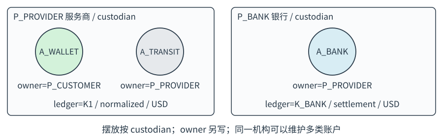
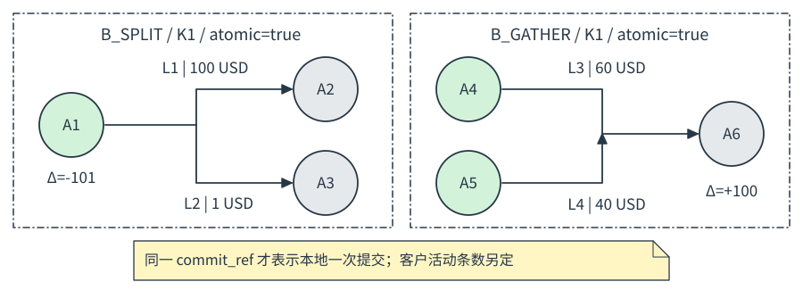
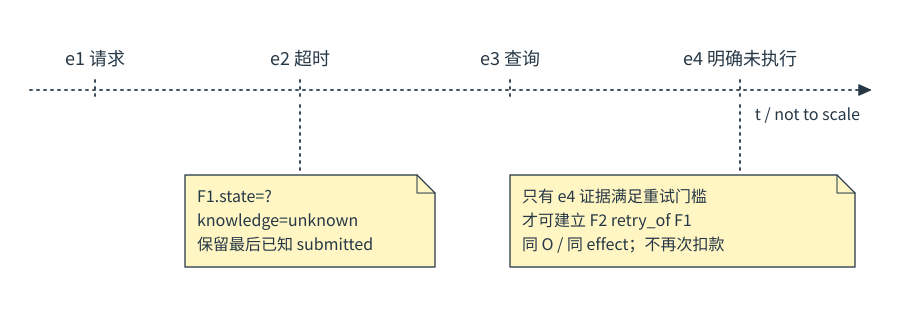
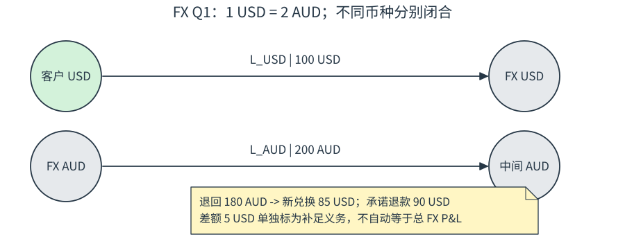
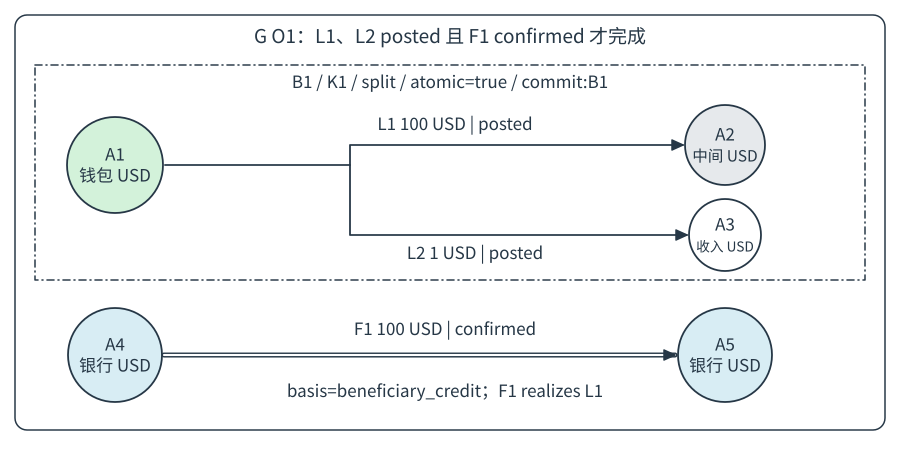
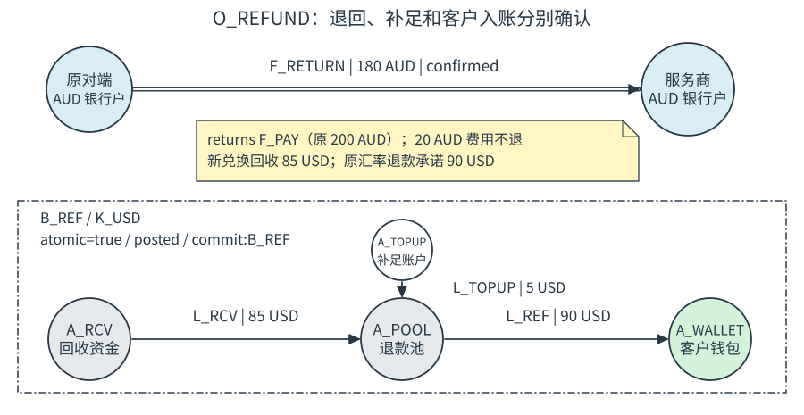
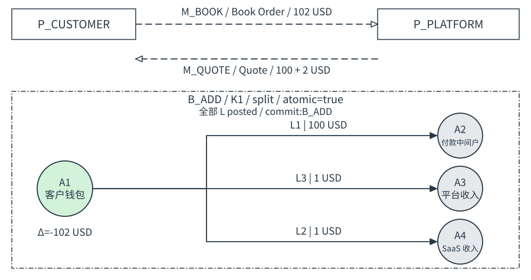

# 金融交易图示法

Financial Transaction Notation · FTN 1.0

**状态：提案规范 / Proposal**　**日期：2026-10-17**

用于跨机构交易的业务分析、方案设计与沟通。沿用原设计的圆形账户、方向箭头、水平时间轴、交易分组和黄色折角注释，增加可识别的对象类型、独立的证据维度和可校验的语义。

本规范的目标是让不同读者对同一张图形成一致判断：谁发出信息、哪个账户发生变化、哪些事实已经确认、剩余义务是什么。


**规范用语：**“必须”是有效模型的约束；“应”是默认绘图约定；“可以”是可选能力。文字标为“示例”“建议”时不增加强制语义。

**阅读顺序：**先读第 1-4 章识别图形，再读第 5-10 章理解时间、异常、费用和 FX；第 11-14 章为场景；第 15-17 章用于形式化校验、编写与迁移。

本语言描述业务事实与约束，不替代复式记账分录、通道协议或法律上的结算终局性判断。核心机器配置覆盖静态快照；完整事件流、汇率政策和经济义务仍需正文约束。

<!-- pagebreak -->

## 1. 最小符号集与视图


| 符号 | 唯一含义 | 必须携带的标识 |
| --- | --- | --- |
| P 矩形容器 | 参与方；可为机构、企业或个人 | party_id 与名称 |
| A 圆形 | 某记账域内、某币种的账户 | account_id、currency、ledger_id |
| L 单实线、实心箭头 | 同一记账域内的账户间价值转移 | leg_id、正金额、batch_id、状态 |
| F 双线、实心箭头 | 外部资金划转的计划或已观测结果 | leg_id、正金额、确认口径、状态 |
| M 长虚线、空心箭头 | 请求、响应、查询或通知消息 | message_id、消息类型、关联标识 |
| G 圆角细实线外框 | 同一业务操作的归组 | operation_id 与完成条件 |
| B 细点划线外框 | 本地记账批次及原子性范围 | batch_id、ledger_id、atomic |
| N 黄色折角便笺 | 解释、前提或证据摘要 | 注释内容；连接线无箭头 |

颜色只用于辅助分类：钱包浅绿、中间账户浅灰、外部银行账户浅蓝、注释浅黄。黑白打印时必须仍能通过 P/A/L/F/M/G/B 和文字完整判读。圆形不得表示银行法人；收入与损益必须标成账户用途。

**视图必须显式声明。** `topology` 表示关系与结构，坐标不表示先后；`timeline` 表示事件时间或偏序。不得将两种视图的坐标语义混用。每张图必须标注 `scenario_id`、视图类型、观察方 `observer` 与快照时点 `as_of`。

本规范图 1-6 为符号教学片段；图 7-9 为场景投影视图。教学片段可以省略完整模型页眉和属性；场景投影省略的属性必须在同页正文或表格中补齐，不能据省略推断未知事实。

**最小入口：**一张简单图只需 P、A、L/F、G 和文字状态；出现消息时才引入 M，出现本地批次时才引入 B。无需给每个场景使用全部符号。

<!-- pagebreak -->

## 2. 对象：参与方、账户与记账域

参与方 P 是承担业务角色的主体。角色如付款方、收款方、服务商、银行可以随场景改变；party_id 标识主体，不标识角色。系统组件可以画在 P 内的独立矩形中，必须用 `component:` 前缀，不能冒充账户。

账户 A 定义为 `(id, owner, custodian, ledger, currency, purpose)`。owner 是本模型明确声明的账户持有人，custodian 是维护账户的机构；二者不能因画在同一个框中就被视为相同。受益权等额外关系应单独写出，不从 owner 自动推导。



| 字段 | 含义与约束 |
| --- | --- |
| ledger_id | 维护一套账户记录的记账域；不是机构的别名 |
| ledger.mode | normalized 为本图的转移余额模型；settlement 为外部结算账户记录域 |
| currency | 单个节点只表示一个币种；多币种钱包展开为多个 A |
| purpose | wallet / transit / revenue / fx_inventory / bank / external_boundary / rounding |
| owner、custodian | 必须指向明确 P；未知信息不能编造，应声明边界假设 |

normalized 模式中的 q(A) 表示该图采用的“转移余额”。L 的源账户减少、目标账户增加；它不是所有总账科目的自然余额，也不等同于会计 Dr/Cr。映射到资产、负债、收入分录时，必须另附该记账系统的分录规则。

external_boundary 表示图外未展开的对端账户，ledger 可以为 null，必须注明省略的范围。它不能掩盖未知的金额、币种或确认结果。普通账户必须指定 ledger；银行账户应使用 settlement 域。

节点放置规则：默认按 custodian 容器摆放，owner 写在账户旁。重复画同一账户必须复用 account_id；时间视图可写 `A1@e3`，它仍然是 A1，而不是新账户。

<!-- pagebreak -->

## 3. 边：账务、资金、信息

**L：本地账务转移。** 两端必须是同一 normalized ledger、同一币种的账户。`planned` 只表示拟入账，`posted` 表示批次已提交，`voided` 表示计划在入账前作废。L 一旦 posted，不得改回 planned 或 voided。

**F：外部资金划转。** 两端必须是同币种的 bank 或 external_boundary 账户；bank 必须位于 settlement ledger。跨银行可以跨 ledger。`planned / submitted / confirmed / failed / cancelled` 只是本图定义的执行描述，必须结合证据、观察方和确认口径阅读。

**M：消息。** 端点是 P 或显式 component；请求和响应各画一条单向边，禁止以双向箭头代替两个事件。消息只证明发送或接收了什么信息，不自动产生 L 或 F。

每条金额边写作 `L1 | 100.00 USD | posted` 或 `F1 | 100.00 USD | submitted`。金额必须为正；负号只允许出现在账户变动 Δq 的说明中。退款画新的反向边，不用“负金额的正向边”。零金额效果不画资金腿；若为解释保留，必须是 `N: no_effect` 注释。

F 的 `confirmation_basis` 必须在 confirmed 时明确为以下之一：`rail_settlement`、`beneficiary_credit`、`available_to_spend`。前者不自动证明后两者；一个图只主张已经取得证据的口径。

F 的 `finality` 独立取 `unassessed / provisional / final`。声明 final 必须同时提供确认事实、证据和 `finality_rule_ref`，明确适用系统与判断规则；本语言本身不授予终局性。

同一经济效果可能同时出现在 L 和 F 中。例如 L1 是客户钱包划入付款中间账户，F1 是银行实际划款。用 `F1 realizes L1` 关联；**不得把两者相加为两次客户付款。** effect_ref 标识一个可独立执行的外部支付单元；分批付款应拆成不同 effect_ref。

状态不得改变线型：pending 的 L 仍是单实线，unknown 的 F 仍是双线。线型只表示事件种类，状态靠标签表达。

<!-- pagebreak -->

## 4. 形式模型、金额与守恒

模型定义为 `D = (P, K, A, O, B, L, F, M, R, C, observer, as_of)`。K 是记账域，O 是业务操作，B 是本地批次，R 是关联，C 是币种精度表。各集合对象 id 必须全局唯一。

以下为类型化抽象语法；JSON 属性名称见第 15 章及 schema.json。

```text
Money      := (currency, minor)       // minor 为正整数
Account    := (id, owner, custodian, ledger?, currency, purpose)
Operation  := (id, required_legs[])    // 完成条件为全部必需效果成功
Batch      := (id, ledger, atomic, composition)
LocalLeg   := (id, from, to, Money, operation, effect, batch,
               state, knowledge=known, posted_at?, commit_ref?)
ExternalLeg:= (id, from, to, Money, operation, effect,
               state?, knowledge, last_known_state?, evidence[],
               confirmation_basis?, finality, finality_rule_ref?)
Message    := (id, from_party, to_party, type, operation,
               attempt_id?, idempotency_key?, occurred_at, evidence)
Relation   := (type, from_ref, to_ref)
```

金额以币种最小单位保存。例如 C(USD)=2 时，100.00 USD 存为 minor=10000。核心配置只允许 `1 <= minor <= 9007199254740991`，拒绝浮点金额；不在 C 中声明的币种无效。零余额可以写成账户摘要，不能成为正金额腿。

对于一条已入账的 L=(a,b,c,m)：`Δq(a,c)=-m`，`Δq(b,c)=+m`。对于任意本地批次 B 与币种 c，必须满足 `sum(Δq(A,c))=0`，且每条 L 都有明确两端。若只画部分账户，仍必须使用 external_boundary 以外的显式本地域对手账户，不能把缺项称为“已平衡”。

**守恒的范围是同一记账域、同一币种、同一余额模型。** L 与 F 不合并求和；不同机构的账簿不合并当成一套总账；USD 和 AUD 不直接相加。此规则只检查图示模型的算术闭合，不能证明会计处理、头寸或流动性正确。

不同币种的交易必须拆成独立币种腿，并用 FX 合约关联。四舍五入残差必须显式分配；不能通过修改另一币种的金额来“凑平”。

<!-- pagebreak -->

## 5. 交易组、本地批次、Split 与 Gather

G/O 表示业务归属，例如一次客户付款。G 可以包含消息、多个本地批次与多个外部资金腿；G 本身不承诺原子性。B 才表示一个本地记账提交范围。



| composition | 定义 | 必须满足 |
| --- | --- | --- |
| transfer | 一个源、一个目标 | 批次恰有一条 L |
| split | 一个源、多个不同目标 | 至少两条 L；源端扣减总额等于各腿之和 |
| gather | 多个不同源、一个目标 | 至少两条 L；目标增加总额等于各腿之和 |
| compound | 其他显式组合 | 所有 L 仍满足同域同币种约束 |

例：`A1 -> A2:100 USD` 与 `A1 -> A3:1 USD` 构成 split，A1 总变化为 -101 USD。**一笔业务操作、两条账务腿、一次本地提交，可以在客户界面聚合成一条扣款活动。** 客户活动条数是展示策略，必须另标 `display: one_activity`，不得由线条数量推导。

`atomic=true` 只允许同一个 ledger，批次中的 L 必须一起 planned、一起 voided，或一起 posted。posted 时所有腿必须具有相同 posted_at 和 commit_ref。图中必须写 `B1 / atomic=true / ledger=K1`，不得把跨机构 G 标成这种本地原子批次。

`atomic=false` 允许批次内分步完成，必须展示实际各腿状态，不能画一个统一的“成功”覆盖部分失败。多币种业务可以包含多个 B，但这并不建立跨批次原子性。

跨机构协调可以另写 `coordination_policy_ref`，包括回退、补偿或分批处理条件。它是业务政策引用，不自动等价于数据库事务或同时结算；核心 JSON 配置暂不包含此扩展。

<!-- pagebreak -->

## 6. 时间、证据与未知结果

timeline 视图使用向右的 t 轴。事件锚点使用 t 轴上的短刻线；时间语义属于事件锚点，不属于圆形本身；同一账户可重复显示，但必须保留同一 id。上下位置仅用于排版或账户轨道，不表示资金规模、优先级或另一时间维度。

每个事件必须标明时间来源：`occurred_at` 是事件发生时间，`observed_at` 是观察方获知时间，`value_date` 是适用时才填写的业务日期。不同来源的时钟不能默认精确可比；只知道先后时使用 `e1 < e2` 的偏序。相同横坐标不保证同时或原子执行。

本规范的示例时间轴为不按比例的事件顺序，均应标 `not to scale`。画出在途区间表示资金腿尚未得到要求的确认；不能把该区间自动解释成资金已经在某个中间账户里。

执行事实与观察知识必须分开：

| knowledge | 图上写法 | 含义 |
| --- | --- | --- |
| known | `state=submitted` 等 | 观察方掌握某个有依据的状态 |
| unknown | `state=?; last=submitted` | 当前结果无法确定；最后已知信息单独保留 |
| disputed | `state=?; disputed` | 存在冲突证据，需要查证，不能择一当真 |

unknown / disputed 的 F 必须把 state 置 null；last_known_state 可以存在，但不能借此断言当前状态。L 只描述已知本地计划或提交，核心配置要求 knowledge=known。

证据至少写明可定位的记录引用，例如通道查询结果、银行入账记录或本地 commit_ref。敏感证据内容不需要复制进图。每张图的 observer/as_of 给出观察边界；不是对全世界资金状态的全知描述。

完整事件扩展可写 `Observation=(subject, claim, occurred_at?, observed_at, source_ref, supersedes?)`，只追加新事实。核心 JSON 保存当前快照和证据引用，不验证事件序列的真实性、来源可信度、因果顺序或时区一致性。

<!-- pagebreak -->

## 7. 状态变化与重试

L 的有效变化是 `planned -> posted` 或 `planned -> voided`；posted 和 voided 对该条记录均为终点。更正 posted 通过新 L 完成，见第 8 章。

F 的常见已知变化是 `planned -> submitted -> confirmed`，或者在收到明确未执行结果时进入 failed / cancelled。planned 也可在提交前 cancelled。允许观察跳过中间状态，但必须有对应证据，不允许从超时推导 failed。



结果未知的原资金腿保持原 id；新增查询消息。重发同一幂等请求仍属于同一 attempt_id、同一外部支付单元和同一 F；**发送次数不是付款次数。** 只有原尝试有明确未执行依据，才可创建替代 F，并以 `new retry_of old` 关联。

新尝试必须使用新 attempt_id。其 idempotency_key 的复用或更新必须按通道协议声明，不能由图示法统一强制；核心校验器不验证通道幂等协议。业务 operation_id 保持不变，外部执行单元的 effect_ref 保持不变。

**重试门槛：**旧 F 的 knowledge=known、state 属于 failed/cancelled、有明确未执行证据；新 F 与旧 F 同 operation、同 effect_ref、同端点、同金额与币种。同一 effect_ref 至多存在一个 confirmed 或当前仍 submitted/unknown/disputed 的 F。failed 只允许表示该单元没有执行；部分执行必须先拆成执行与未执行的单元。

`retry_of` 是执行替代，不是退款关系。若旧付款已 confirmed，随后资金被退回，再次付款必须创建新的 effect_ref，保留 return 与新付款的关系；不能把原成功付款改为 failed 后复用重试逻辑。

状态图用于解释默认路径；核心校验器检查快照门槛，不读取完整状态历史。真实接入时必须另验证历史转换、通道取消含义和重复请求行为。

<!-- pagebreak -->

## 8. 不可变历史、更正与资金退回

原则修订为：**已发生事实和已入账记录不覆盖修改；后续取消、冲正、退款及退回通过新增事件或交易表达，并关联原记录。** 尚未执行的意图可以终止，但不能抹掉已经发送消息的事实。

| 关联类型 | 严格含义 | 适用端点 |
| --- | --- | --- |
| realizes | 外部划款承接某条本地账务腿表达的业务效果 | F -> L |
| reverses | 同域同币种、等额反向的本地更正 | 新 posted L -> 原 posted L |
| returns | 外部资金沿原路径反向退回，可以部分退回 | 新 confirmed F -> 原 confirmed F |
| refunds | 新退款业务操作源自原业务操作 | 新 O -> 原 O |
| retry_of | 明确未执行后的替代执行 | 新 F -> 旧 F |
| caused_by | 原因关联，不附带金额或完成推导 | 现有对象 -> 现有对象 |

关联方向统一是“新对象指向被关联对象”。reverses 不删除原 L；两条一起形成净效果。returns 的累计金额不得超过原 F，除非超出部分另立业务效果；费用补偿不得偷偷并入原款退回。

refunds 只表明业务来源，不自动要求原路、等额、原币种，也不自动豁免退款上限。必须附退款政策，声明可退本金、费用、币种、汇率、已退累计与本次额度。核心配置不自动校验跨币种退款限额。

reverses 严格要求等额；部分更正可拆分为对原腿的完整冲正加正确的新腿，或者使用 caused_by 与明确更正政策记录部分补偿，不能滥用等额冲正标记。对同一原 L 的等额 reverses 至多一条；若需更正冲正，关联被更正的冲正腿，保留链条。

客户退款、银行退回、本地冲正和再次付款必须有不同 id。界面可以聚合，但图中必须保留可追溯关系。未确认的反向资金只能标 submitted 或 unknown，不能画成已确认退款。

<!-- pagebreak -->

## 9. 费用、锁定金额与舍入

费用必须区分：承担方 `borne_by`、实际扣收账户 `collected_from`、收取方 `earned_by`、计费基数 `fee_base`、币种、舍入方式及退款政策。界面不可见不意味着经济效果或会计归属可以省略。

锁定金额使用明确字段，禁止单写 Lock Source / Lock Target：

| 名称 | 锁定量 | 说明 |
| --- | --- | --- |
| source_total | 付款人总支出 S | 包括此口径下由付款人承担的费用 |
| source_principal | 参与兑换的源本金 P | 不含外加费用 |
| target_gross | 目标币种毛额 G | 目标侧扣费前金额 |
| target_net | 受益人净到账 N | 目标侧费用扣除后的金额 |

在“只含一笔比例费用、按本金计费、无最低费用、固定汇率”的示例政策下，r 为每单位源币得到的目标币，f 为费率：

```text
付款人付费：S = P + round(P*f);  G = round(P*r); N = G
受益人付费：S = P; G = round(P*r); G = N + round(N*f)
```

给定锁定总额时必须按整数最小单位求解以上等式；不得各项独立近似后破坏金额恒等式。比例费用按毛额还是净本金计费必须明确，不能从“内扣”自动推断。

| 锁定与政策 | 源币 CNY | 目标币 USD | 示例结果 |
| --- | --- | --- | --- |
| source_total=1000；付款人费按 P 的 1% | P=990.10；费=9.90 | N=99.01 | S=1000.00 |
| source_total=1000；受益人费按 N 的 1% | P=1000.00 | G=100；N=99.01；费=0.99 | 毛额不等于净到账 |
| target_net=100；付款人费按 P 的 1% | P=1000；费=10 | N=100 | S=1010.00 |
| target_gross=100；受益人费按 N 的 1% | P=1000 | N=99.01；费=0.99 | 不能称 target_net=100 |

上表 r=0.1 USD/CNY，保留两位小数，half_up。若受益人费用改按 G 的 1% 计算，则 G=100 时 N=99，而不是 99.01。若锁定 target_net=100、仍按 N 收费，则 G=101，P=1010。不同政策必须分别建例。

每个费用组件应有独立标识；退不退、谁吸收、是否再收费均为显式政策。差额使用 rounding 账户或声明的分配规则处理，不得默认为收入。

<!-- pagebreak -->

## 10. FX、报价方向与损益口径

FX 合约定义为 `(quote_id, base_ccy, quote_ccy, rate, side, source_ref, quoted_at, expires_at, rounding_policy)`。rate 表示每 1 base_ccy 可兑换多少 quote_ccy；本规范的示例始终同时写单位等式。

source_ccy / target_ccy 描述本笔资金支出与收到的币种，不是 base_ccy / quote_ccy 的别名。买卖方向必须注明观察方，bid/ask 必须注明报价提供方。不得将历史示例汇率理解成可成交报价。

例：`1 USD = 2 AUD`。客户 USD 钱包转出 100 USD 到 USD FX 库存；AUD FX 库存转出 200 AUD 到 AUD 付款中间账户。它们是两个币种域内的 L，并由一个 FX 合约关联；不存在直接从 USD 账户指向 AUD 账户的单条 L 或 F。



**退回演算：**原外部付款 200 AUD，银行扣收已声明不可退费用 20 AUD，实际退回 180 AUD。新兑换政策为 `1 AUD = 0.4722 USD`，按 half_up 到美分，收到 `round(180*0.4722)=85.00 USD`。

若合同退款政策锁定原汇率 `1 AUD=0.5 USD` 且客户承担 20 AUD 费用，则承诺退客户 `180*0.5=90.00 USD`。本次已回收美元 85.00 与该退款义务 90.00 之间存在 5.00 USD 缺口，必须写明由谁补足。若由服务商承担，可画额外 L 从服务商补偿资金账户划入退款池。

这里的 5.00 USD 是在指定退款政策和回收口径下的资金缺口；**不能直接宣称是整笔交易的总 FX P&L**。确认会计损益还需要原始成本、对冲、估值时点、功能币和相关分录。不能把守恒残差一律命名为 FX P&L。

舍入残差：180*0.4722=84.996 USD，舍入后为 85.00；0.004 USD 是计算精度残差，不可作为 0.004 USD 的现金腿。若会计域支持更高精度，必须另声明单位与舍入归集策略。核心 JSON 只保存最终最小单位金额，不计算 FX 或损益。

<!-- pagebreak -->

## 11. 标准场景 A：付款、本地费用与外部到账

**图属性：**scenario=SC_PAYOUT；view=topology；observer=P_PROVIDER；as_of=2026-10-17T09:30:00+08:00；USD 精度 2。

**前提：**余额足够；本金 100 USD，服务费 1 USD。钱包位于服务商 normalized 域；银行账户位于各自 settlement 域。本例仅展示本次变化。



| 对象 | 内容 | 确认依据 |
| --- | --- | --- |
| O1 | 客户付款；required_legs=[L1,L2,F1] | 全部必需效果成功 |
| B1 | split；atomic=true；ledger=K1 | 同一 commit_ref |
| L1 | 钱包 -> 付款中间账户；100 USD；posted | 本地提交记录 |
| L2 | 钱包 -> 服务费收入账户；1 USD；posted | 同一提交记录 |
| F1 | 服务商银行账户 -> 受益人银行账户；100 USD | 银行到账证据；basis=beneficiary_credit |

`F1 realizes L1`。101 USD 是客户钱包的本次总减少，100 USD 是外部本金，1 USD 是本地费用；不得相加成 201 USD。客户展示可为 one_activity，但图中仍有两条 L。

L1/L2 posted 不证明外部到账；F1 confirmed 后 O1 才完成。本例省略中间账户清理与总账对账；O1 completed 不代表这些工作已经结束。

**余额摘要：**Δq(wallet)=-101 USD；Δq(transit)=+100 USD；Δq(revenue)=+1 USD。本地变化合计为零。外部 F1 的两端单独观察，不并入这一组本地变化。

账户映射：A1=A_WALLET；A2=A_TRANSIT；A3=A_REVENUE；A4=A_PROVIDER_BANK；A5=A_BENE_BANK。完整属性与请求 M1 见 examples/payout.json；这是拓扑快照，坐标不表示时间。

<!-- pagebreak -->

## 12. 标准场景 B：超时、查询与替代执行

**前提：**沿用 O1 的本金和本地 B1，不再次扣客户钱包。本例按时间推进，任一时点的知识只属于当时的观察方。

```text
e1: M1 发送付款请求，attempt_id=ATT1，F1=submitted
e2: 请求超时，F1.state=null，knowledge=unknown，last=submitted
e3: M2 查询原支付单元；不生成新资金腿
e4: 得到明确未执行依据，F1=failed，knowledge=known
e5: 新尝试 ATT2，生成 F2；F2 retry_of F1
e6: F2=confirmed，basis=beneficiary_credit，有到账证据
偏序：e1 < e2 < e3 < e4 < e5 < e6；不按比例
```

在 e2，O1 保持未完成，不能释放本地已扣本金并假定对方不会执行。是否冻结、转入何种中间账户，必须有具体本地 L 或 H 扩展记录；不能从 unknown 一词推导余额操作。

在 e4，证据必须说明该支付单元未执行。仅“请求被拒绝”而无法确定先前请求是否执行，不满足重试门槛。若得到的是已确认部分执行，则先划分部分执行单元，不能把整个 F1 标为 failed。

F2 的 effect_ref 与 F1 相同，表示替代同一个支付单元。F2 的 id 和 attempt_id 新建；通道幂等键遵循已声明通道协议。新的成功快照把 O1 的 required_legs 更新为 [L1,L2,F2]，保留旧快照及 F1 的失败事实。

若 e3 得到“已到账”，继续使用 F1，并更新为 confirmed；没有 F2。若得到冲突结果，则 knowledge=disputed，仍不得启用替代执行。

完整快照见 examples/unknown.json 与 examples/retry.json。它们演示未知与后来替代成功；静态校验器不证明两个文件之间实际发生了正确的时间序列。

<!-- pagebreak -->

## 13. 标准场景 C：部分退回、换汇与退款

**前提：**原付款 O_PAY 已有 confirmed 的 F_PAY=200 AUD。银行保留 20 AUD 的费用，该费用政策在付款前已声明；F_RETURN=180 AUD 从受益人侧路径退回服务商银行账户，并以 `F_RETURN returns F_PAY` 关联。

本图 view=topology；observer=服务商；as_of=2026-10-17T12:00:00+08:00；USD/AUD 精度 2。本地账户由服务商维护并持有，A_WALLET 除外（客户持有）；外部账户属性沿用原付款。

`O_REFUND refunds O_PAY` 表明退款业务来源；保留原付款事实。退回原因用 caused_by 或注释注明，不能只靠反向箭头猜测。



本例分成四步：

1. 确认退回 180 AUD，差额 20 AUD 属于已声明费用。
2. 新 FX 合约兑换回收款，得到 85.00 USD；换汇必须拆腿。
3. 客户应得 90.00 USD；A_TOPUP 提供额外 5.00 USD。
4. L_REF 把 90.00 USD 转入客户钱包；若退到银行，必须另建 F。

O_REFUND 完成条件包括退回确认、换汇完成、补足及钱包入账。图示 B_REF 在 K_USD 内一次提交三条 posted L，使用同一 commit_ref。费用退款逐项依政策判断，本例不假定服务商手续费退还。

**对照：**若退款政策改为按实际回收的新汇率退，则客户可能只得到 85.00 USD，服务商无需此 5.00 USD 补足。两者是不同产品承诺，必须画成两个场景，不能只替换图中一个金额。

本章为扩展示例；完整校验还需实现 FX/退款政策与额度检查，不声称由核心 JSON 覆盖。

<!-- pagebreak -->

## 14. 标准场景 D：平台附加费用与信息流

客户支付 102 USD，其中本金 100、平台费用 1、SaaS 服务费 1。客户看到“总费用 2 USD”是允许的聚合展示，但费用归属必须在模型里展开。



Quote 是报价消息，Book Order 是订单请求消息；它们都使用 M。Charge Fee 只有实际发生账户转移时才使用 L。消息内容带有金额也不改变 M 的类型；不能据此认定已经收款。

同一个 normalized ledger 内可建立 B_ADD split：客户钱包 -102，付款中间账户 +100，平台收入账户 +1，SaaS 收入账户 +1。每个账户的 owner/custodian 必须显式声明。若平台和 SaaS 实际属于不同记账域，则本例的单批次前提不成立，应拆为多个本地 B 和外部 F。

报价必须关联 quote_id 和 operation_id；报价有效期、费用版本与承诺金额应可追溯。超过有效期的重新报价是新消息和新报价版本，不能覆盖原客户接受过的报价记录。

“SaaS 对客户不可见”只影响显示视图。用于设计、计费归属与对账的视图仍须保留 SaaS 及其费用账户，或明确标注未展开的边界。展示边界、机构边界、账户维护域与原子批次不能共用一个未命名外框。

图中 A1/A2/A3/A4 分别为客户钱包、付款中间户、平台收入和 SaaS 收入；账户币种均为 USD，后三者归属依次为服务商、平台、服务商（SaaS）。本例 observer=服务商，as_of=2026-10-17T09:30:00+08:00，view=topology。

**图面命名规则：**容器写 P；本地提交写 B；业务操作写 G；灰色填充只作视觉辅助，不定义“内部”“不可见”或“原子性”。附加费是否可退、实际收取时间与服务是否履行，继续由明确政策规定。

完整核心机器样例见 examples/addon.json。本例不包含外部付款，其 O_ADD 完成条件仅代表本地分配完成，不能拿它证明受益人已经到账。

<!-- pagebreak -->

## 15. 核心 JSON 配置与校验规则

schema.json 使用 JSON Schema 2020-12，限制对象字段、枚举、正整数金额和条件性必填项。tools/validate.py 在此基础上检查跨对象引用和以下核心语义。示例金额均为最小单位整数。

```json
{
  "id": "L1", "kind": "L", "from": "A_WALLET", "to": "A_TRANSIT",
  "money": {"currency": "USD", "minor": 10000},
  "operation_ref": "O1", "effect_ref": "E_PRINCIPAL",
  "batch_ref": "B1", "state": "posted", "knowledge": "known",
  "posted_at": "2026-10-17T09:00:00+08:00", "commit_ref": "commit:B1"
}
```

| 规则 | 核心校验器检查内容 |
| --- | --- |
| R01 | 对象 id 全局唯一；observer、owner、custodian 等引用存在 |
| R02 | 金额为已声明币种的正整数最小单位；拒绝浮点与负金额 |
| R03 | L 同 normalized ledger；F 只连接合格外部账户；两端同币种 |
| R04 | L 必须属于同 ledger 的 B；每个 B 非空且只属一个 O |
| R05 | Split/Gather/transfer 的源与目标基数符合定义 |
| R06 | atomic=true 的腿同状态；posted 的时间与 commit_ref 一致 |
| R07 | posted L 有提交标识；confirmed F 有 evidence 和确认口径 |
| R08 | unknown/disputed 的 F.state=null；known 的 F 有明确 state |
| R09 | final 声明必须是已知 confirmed，且有规则与证据 |
| R10 | 同 effect_ref 至多一个 confirmed 或仍可能执行的 F |
| R11 | retry_of 满足已知未执行、同金额端点及同操作/执行单元 |
| R12 | reverses 等额同币种反向、双方 posted；同原腿最多一次 |
| R13 | returns 同币种反向、双方已知 confirmed；累计不超原额 |
| R14 | required_legs 非空且属于该 O；realizes 为同操作/执行单元、同金额的 F -> L |

消息必须有 id、类型、关联 O、时间和证据。付款请求还必须有 attempt_id 和 idempotency_key，订单创建请求必须有幂等键；报价、查询、响应的幂等键可以为 null，不能把消息关联号当成幂等承诺。核心样例仅使用 P 端点，component 属绘图扩展；消息与资金腿的精确 attempt 映射依业务接入规则确认，校验器不解析证据。

本地转移的逐币种净变化由每条腿的两端自动计算；它是 R03/R04 模型约束的结果，不能代替对业务金额、余额充足性、真实分录或账户真实性的验证。

<!-- pagebreak -->

## 16. 完成条件、扩展与符合性

核心完成条件为 `all_required_effects`。成功判定：L 必须 posted；F 必须 knowledge=known 且 confirmed。最终快照的 required_legs 应引用当前承担义务的腿；被替代的失败尝试保留在图中，但不继续作为必须成功的目标。

```text
success(x) = (x.kind=L and x.state=posted)
          or (x.kind=F and x.knowledge=known and x.state=confirmed)
terminal(x) = success(x) or x.state in {voided, failed, cancelled}
completed = every required x satisfies success(x)
closed_unsuccessful = every required x is terminal and not completed
partial = some required x succeeds and neither condition above holds
open = otherwise
```

结果由工具派生，不另存一个可随意填写的“成功”。这个 outcome 只针对声明的 required_legs：`closed_unsuccessful` 不保证已退钱或完成补偿，`completed` 不保证所有中间账户归零或对账完结。财务收尾必须另列义务与完成条件。

**扩展配置：**H 表示余额预留/释放；Q 表示 FX 报价；Policy 表示费用与退款政策；Observation 表示追加证据事件。扩展必须声明名称、版本、字段、绘图方式与校验范围。核心校验器不接受未知字段，扩展应独立保存并引用核心 id。

H 至少区分 booked_balance 与 available_balance；预留不画成到账另一方的 L。Q 必须携带单位方向、有效期与舍入规则。Policy 必须说明费用和退款上限。Observation 必须保留观察时间及来源。这些能力在正文中有语义要求，但没有在本交付中实现完整计算引擎。

| 符合级别 | 可以声称什么 | 不能声称什么 |
| --- | --- | --- |
| Diagram | 满足图形规则、类型和明确假设 | 机器校验已通过 |
| Core | JSON Schema 与 R01-R14 通过 | 真实支付发生、政策正确或事件历史合法 |
| Domain | Core 加具体费用/FX/额度/证据规则 | 自动符合某清算系统或法律终局性 |

交付中的四个 JSON 样例达到 Core 范围；示例图为 Diagram 层，部分图使用正文定义的扩展政策。PDF 中的示意图不声称由 JSON 自动布局生成，涉及同一场景的金额与关系必须人工和脚本交叉核对。

<!-- pagebreak -->

## 17. 编写模板、迁移与参考

**每张图的固定页眉：**场景名称与 id；view；observer；as_of；计价币种及精度；前提与省略范围。**固定页脚：**完成条件；费用/退款政策引用；证据来源；未决事项。

编写顺序：先定参与方和账户维护域，再列账户与币种；写出客户承诺和所需效果；展开本地 B/L、外部 F 和 M；补状态与证据；最后调整布局。不可通过移动节点或改变颜色来修复语义缺失。

| 原记法 | 迁移到 FTN 1.0 |
| --- | --- |
| Bank / MP 圆形 | 若为主体则 P；若为账户则 A 并标 owner/custodian |
| 虚线 pending | 保留 L/F 类型，附状态和 knowledge 标签 |
| Split / Gather | B.composition；另标 atomic 与客户展示策略 |
| 反向退款箭头 | 新 id；明确 reverses、returns 或 refunds |
| Lock Target | 明确 target_gross 或 target_net |
| AUDUSD=0.5 | 同时写 `1 AUD=0.5 USD` 及报价/时点 |
| 零金额灰色分支 | 默认省略；需要说明时改为 N:no_effect |
| 图中一个“成功” | 根据 required_legs 与具体确认口径派生结果 |

**读图验收：**给未参与设计的读者一张图，要求独立指出主体、账户、客户总支出、净到账、已确认事实、未知结果、下一步允许的动作、退款责任与完成条件。若答案依赖作者口头补充，优先补定义与政策，避免继续增加符号。

**参考与来源边界：**本规范的图形和形式语法是基于用户原始 OmniGraffle 设计重新整理的提案；L/F/M 等标识、知识维度、核心配置和规则编号均为本规范自行定义。

CPMI 的术语表提供 payment order、book entry、funds transfer、final settlement 等术语参考；本规范据此避免把指令、记账和结算混称为一个动作，并未复制其定义作为 FTN 的外部合规承诺。

- [BIS / CPMI Glossary](https://www.bis.org/committees/cpmi/glossary)
- [PFMI Principle 8: Settlement finality](https://www.bis.org/committees/cpmi/pfmi/overview)

PFMI 第 8 原则强调明确结算最终完成的时点及不得撤回的界线。本规范采用“终局性须引用具体规则”的设计约束；实际适用范围取决于相关系统与安排。参考访问日期：2026-10-17。
